# Langflow Workshop

[](https://www.langflow.org/desktop)
[](https://opensource.org/licenses/MIT)

## Description

This repository contains setup instructions, datasets, visual guides, and pre-built workflows for the hands-on **Langflow Workshop** for AI Keralam Community

---

## Table of Contents

- [Prerequisites: Google Gemini API Setup](#prerequisites-google-gemini-api-setup)
  - [Step 1: Open Google AI Studio](#step-1-open-google-ai-studio)
  - [Step 2: Navigate to API Keys via Dashboard](#step-2-navigate-to-api-keys-via-dashboard)
  - [Step 3: Click Create API Key](#step-3-click-create-api-key)
  - [Step 4: Name Your Key & Select Create Project](#step-4-name-your-key--select-create-project)
  - [Step 5: Name and Create Your Cloud Project](#step-5-name-and-create-your-cloud-project)
  - [Step 6: Confirm Project Creation & Generate Key](#step-6-confirm-project-creation--generate-key)
  - [Step 7: Copy Your API Key](#step-7-copy-your-api-key)
- [Installation: Langflow (Desktop & Linux)](#installation-langflow-desktop--linux)
  - [Step 1: Access the Download Page](#step-1-access-the-download-page)
  - [Step 2: Request the Desktop App](#step-2-request-the-desktop-app)
  - [Step 3: Select Your Operating System & Download](#step-3-select-your-operating-system--download)
  - [Step 4: Install the Application (Windows & macOS)](#step-4-install-the-application-windows--macos)
  - [Linux Installation via uv (Ubuntu, Debian, Fedora, Arch)](#linux-installation-via-uv-ubuntu-debian-fedora-arch)
  - [Step 5: Launch Langflow & Create a New Flow](#step-5-launch-langflow--create-a-new-flow)
- [Verification: Testing Your Gemini API Key](#verification-testing-your-gemini-api-key)
  - [Step 1: Create a Blank Flow](#step-1-create-a-blank-flow)
  - [Step 2: Add Chat Input Component](#step-2-add-chat-input-component)
  - [Step 3: Add Google Generative AI (Avoid Embeddings!)](#step-3-add-google-generative-ai-avoid-embeddings)
  - [Step 4: Configure Model to gemini-3-flash-preview](#step-4-configure-model-to-gemini-3-flash-preview)
  - [Step 5: Add Chat Output Component](#step-5-add-chat-output-component)
  - [Step 6: Wire the Components](#step-6-wire-the-components)
  - [Step 7: Run the Test in Playground](#step-7-run-the-test-in-playground)
- [Workshop Readiness Checklist](#workshop-readiness-checklist)
- [Features](#features)
- [Troubleshooting](#troubleshooting)
- [License](#license)

---

## Prerequisites: Google Gemini API Setup

Langflow requires an LLM provider to power its reasoning agents. We use **Google Gemini** through Google AI Studio because it offers a generous free tier with zero upfront costs and no credit card requirement.

Follow this step-by-step visual guide to create your project and generate your API key:

### Step 1: Open Google AI Studio

1. Open your browser and navigate to **[https://aistudio.google.com/](https://aistudio.google.com/)**.
2. Sign in with your standard Google Account.
3. In the left navigation menu under **MANAGE**, click on **Dashboard**.

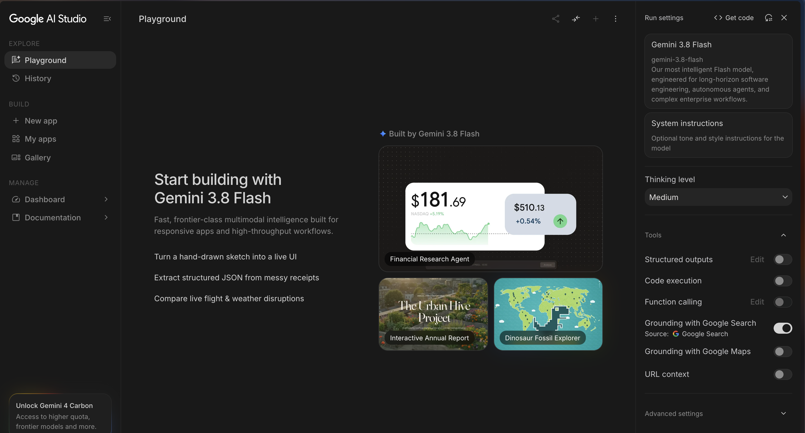

---

### Step 2: Navigate to API Keys via Dashboard

1. On the Dashboard view, locate the **PROJECT** section on the left sidebar.
2. Click on **API Keys** to open your key management console.

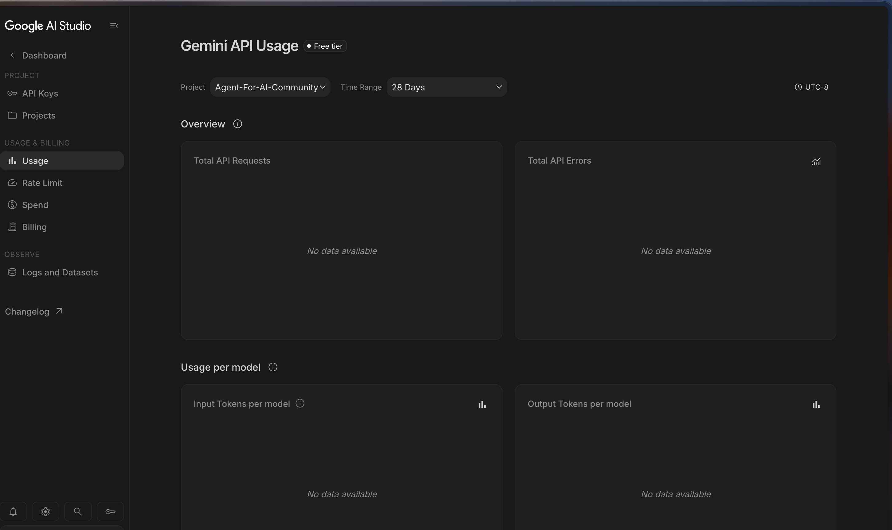

---

### Step 3: Click Create API Key

1. On the top right of the **API Keys** screen, click the **`Create API key`** button.

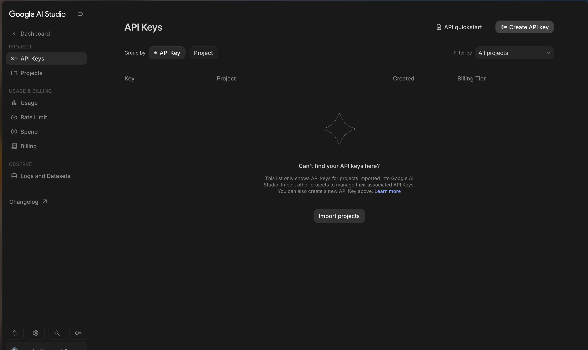

---

### Step 4: Name Your Key & Select Create Project

In the **Create a new key** dialog:
1. Enter a descriptive key name under **Name your key** (e.g., `Langflow_Agent`).
2. Under **Choose an imported project**, click the dropdown.
3. If you do not have an existing project listed, select **`+ Create project`**.

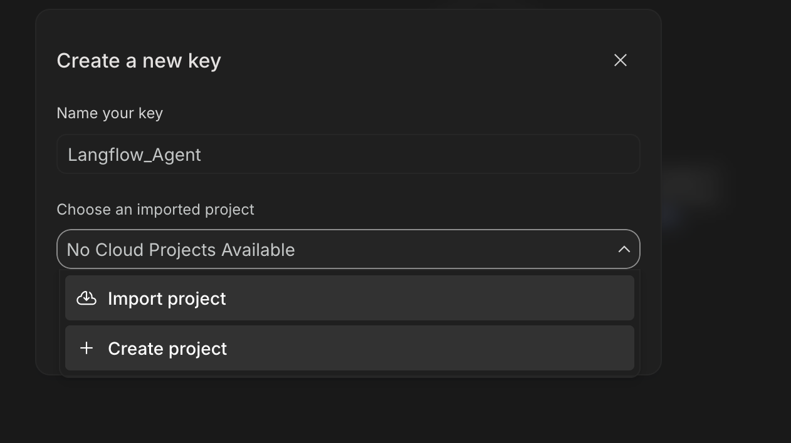

---

### Step 5: Name and Create Your Cloud Project

A secondary pop-up dialog titled **Create a new project** will appear:
1. Enter your desired project name under **Name your project** (e.g., `Langflow-Project`).
2. Click the **`Create project`** button.

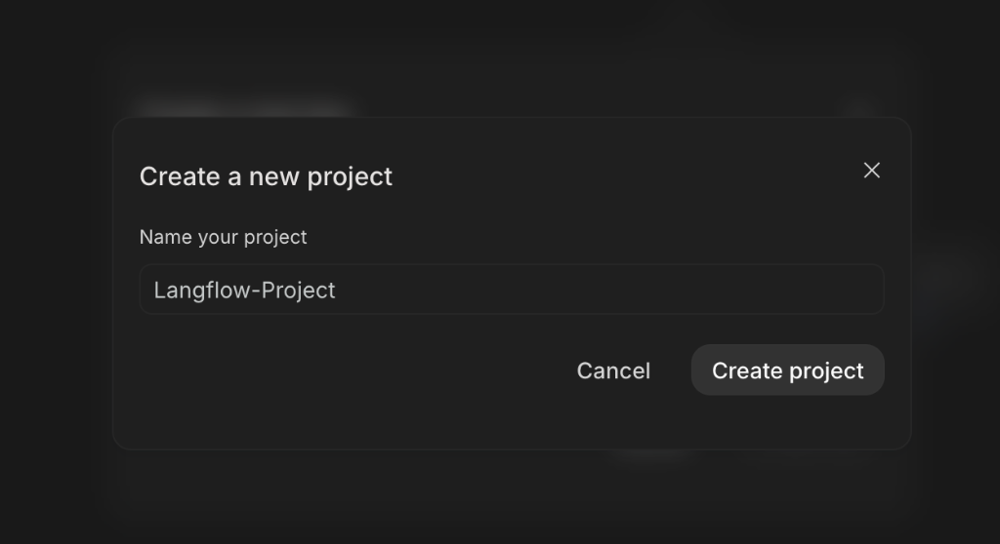

---

### Step 6: Confirm Project Creation & Generate Key

1. A green confirmation banner saying **`✓ New project created!`** will appear at the top.
2. The project dropdown will now reflect your newly provisioned project (`Langflow-Project`).
3. Click the blue **`Create key`** button in the lower right of the modal.

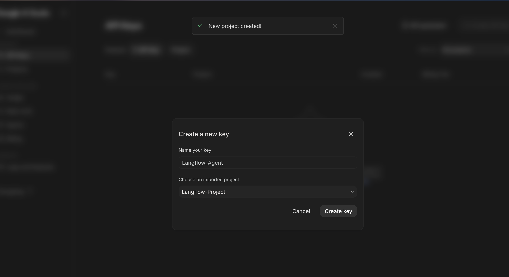

---

### Step 7: Copy Your API Key

1. The **API key details** modal will appear displaying your new key string, project name, and project number.
2. Click the **`Copy key`** button (or the copy icon next to the key string).
3. Store this key safely. You will paste it directly into the **Google Generative AI** component inside Langflow.

> [!IMPORTANT]
> Keep your API key private. Never share it publicly or commit it into version control.

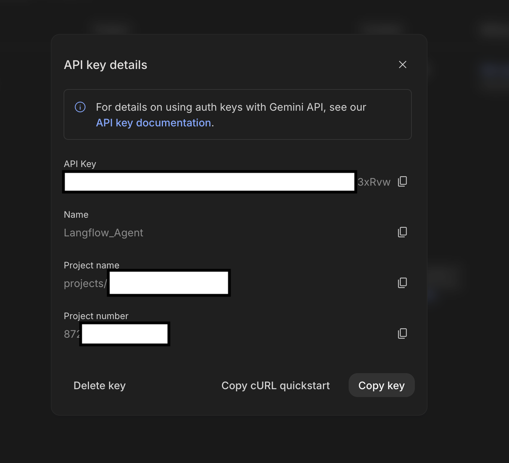

---

## Installation: Langflow (Desktop & Linux)

For **macOS** and **Windows**, you can use the standalone **IBM Langflow Desktop** application (an all-in-one graphical installer with zero terminal or Python setup required).

For **Linux distributions** (Ubuntu, Debian, Fedora, Arch, openSUSE, etc.), Langflow can be run in seconds using **`uv`**, the ultra-fast modern Python runner.

### Step 1: Access the Download Page (macOS & Windows)

1. Open your browser and go to the official website: **[https://www.langflow.org](https://www.langflow.org)**.
2. In the top navigation bar, click on **Download**.

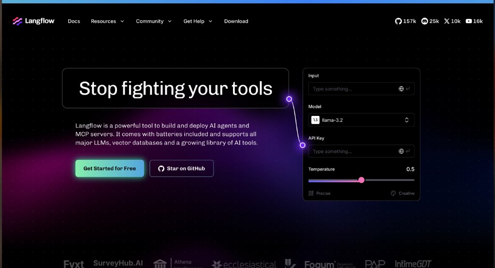

---

### Step 2: Request the Desktop App

1. You will be directed to the **Langflow for Desktop** page: **[https://www.langflow.org/desktop](https://www.langflow.org/desktop)**.
2. Under **Download the App** on the right side, fill in the registration form:
   - First Name & Last Name
   - Email address
   - Country
   - Company / Institution (or "Student" / "Self")
3. Check the agreement box and click the green **Download** button.

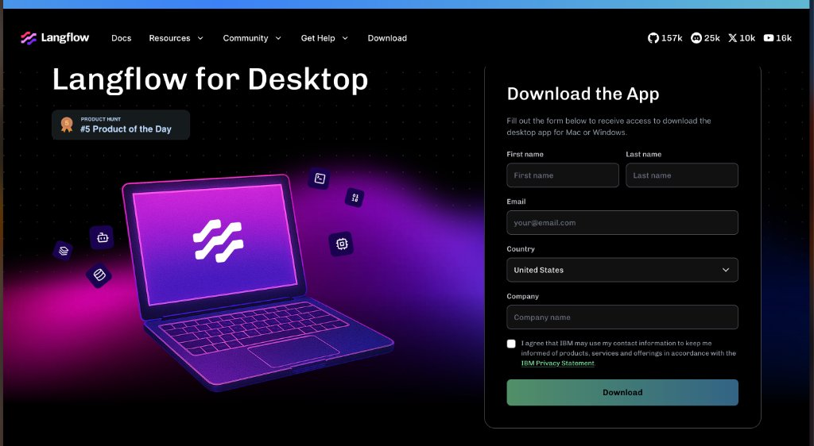

---

### Step 3: Select Your Operating System & Download

After submitting the form, the download options for your platform will be displayed:
- **macOS (Apple Silicon)**: For Apple M1, M2, M3, or M4 Macs.
- **macOS (Intel)**: For older Intel-based Macs.
- **Windows (x64)**: For 64-bit Windows 10 and 11 laptops.

Click the **Download** button next to your operating system to download the installer file (`.exe` or `.dmg`).

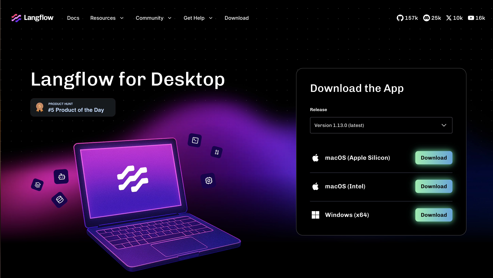

---

### Step 4: Install the Application (Windows & macOS)

#### For Windows:
1. Open your `Downloads` folder and double-click the downloaded `.exe` installer.
2. If Windows SmartScreen displays a warning (*"Windows protected your PC"*), click **More info**, then click **Run anyway**.
3. Follow the installation wizard prompts to complete setup.
4. Launch **IBM Langflow Desktop** from your Windows Start menu.

#### For macOS:
1. Double-click the downloaded `.dmg` file.
2. Drag the **IBM Langflow Desktop** icon into your **Applications** folder.
3. Open **Applications** and launch **IBM Langflow Desktop**.

---

### Linux Installation via uv (Ubuntu, Debian, Fedora, Arch)

Since Langflow Desktop is currently distributed as native packages for macOS and Windows, Linux users can install and run Langflow seamlessly using **`uv`** (Astral's ultra-fast Rust-based Python package manager). `uv` provides isolated execution, eliminates dependency conflicts with system packages, and installs packages up to 10–100× faster than standard `pip`.

#### 1. Install `uv`
If `uv` is not already installed on your system, open a terminal and run:
```bash
curl -LsSf https://astral.sh/uv/install.sh | sh
source $HOME/.cargo/env
```
*(Verify installation by running `uv --version`. For other distribution package managers, pipx, or advanced options, refer to the official [uv Installation Guide](https://docs.astral.sh/uv/getting-started/installation/)).*

#### 2. Run Langflow (Instant One-Liner via `uvx`)
Use `uvx` to download and execute Langflow in an isolated ephemeral environment without manual virtual environment configuration:
```bash
export LANGFLOW_AUTO_LOGIN=true
uvx langflow run
```

> [!TIP]
> Setting `LANGFLOW_AUTO_LOGIN=true` bypasses the initial authentication prompt and takes you directly to the workspace dashboard.

#### Alternative: Install as a Persistent CLI Tool
If you prefer a persistent installation across terminal sessions:
```bash
uv tool install langflow
export LANGFLOW_AUTO_LOGIN=true
langflow run
```

#### 3. Access the Web Interface
Once Langflow starts, your terminal will display:
```text
INFO:     Langflow is running at: http://127.0.0.1:7860
```
Open your browser and navigate to **[http://127.0.0.1:7860](http://127.0.0.1:7860)**. You will be greeted by the exact same home dashboard as the desktop application.

---

### Step 5: Launch Langflow & Create a New Flow

1. Open **IBM Langflow Desktop** (on macOS/Windows) or visit **`http://127.0.0.1:7860`** in your browser (on Linux). You will land on the **Starter Project** home dashboard displaying your workspace flows.
2. Click on the **`+ New Flow`** button in the upper right.

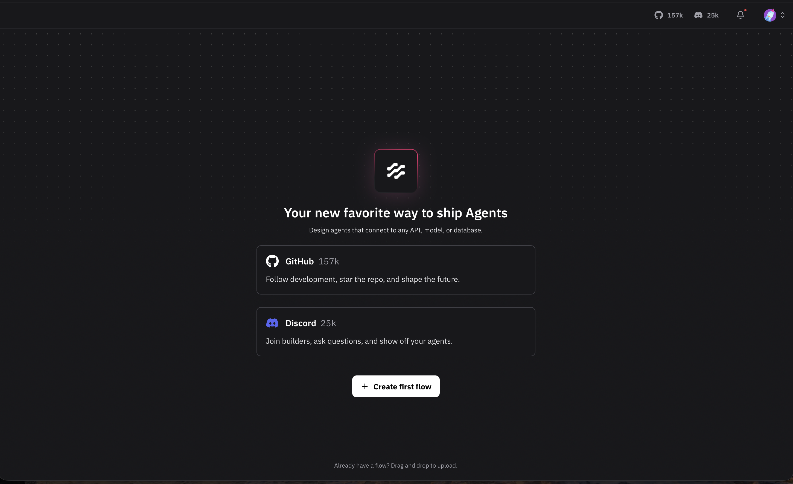

3. The flow builder canvas opens displaying the initial setup dialog (*"Let us set things up first"*). From here, you can click on **Blank Flow** or pick a starter template to begin designing your AI agents!

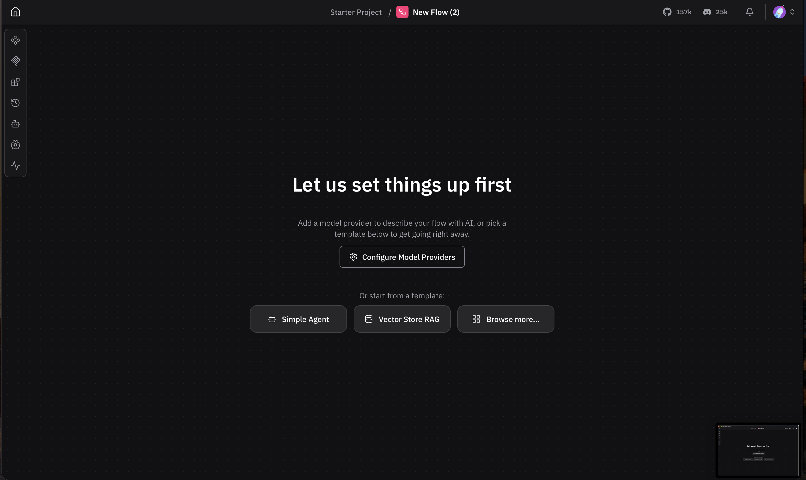

---

## Verification: Testing Your Gemini API Key

Before diving into complex agent workflows, build this lightweight **3-node verification flow** to ensure your Gemini API key is valid, active, and communicating smoothly with Langflow.

### Step 1: Create a Blank Flow

1. On the initial popup modal (*"Let us set things up first"*), click **Blank Flow** (or click the **`+ New Flow`** button on your dashboard).
2. You will be greeted with a blank visual grid canvas.

---

### Step 2: Add Chat Input Component

1. In the left component sidebar, click the search bar at the top and type **`Chat`** (or open the **Input & Output** category).
2. Locate **`Chat Input`** in the list.
3. Click and drag **`Chat Input`** onto the left side of your canvas.

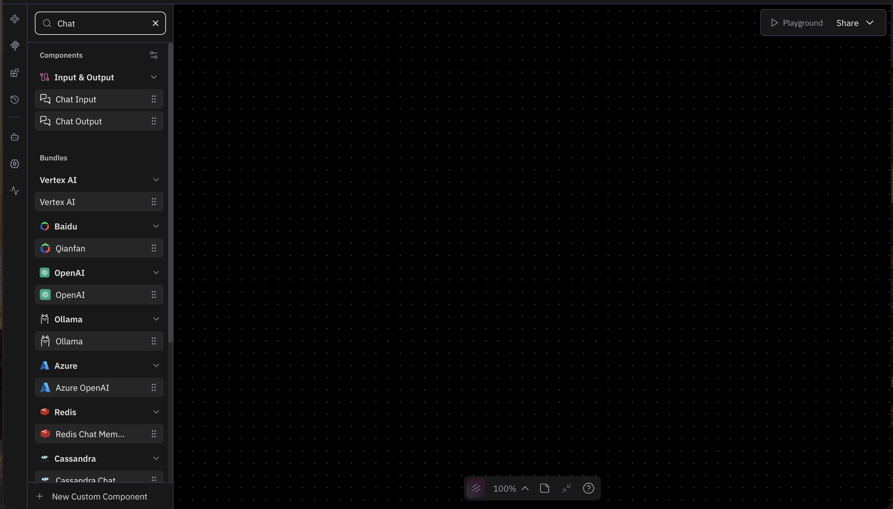

---

### Step 3: Add Google Generative AI (Avoid Embeddings!)

1. In the left component sidebar search bar, type **`Google Generative AI`** (or navigate to **Models & Agents** → **Google**).
2. Under the **Google Generative AI** bundle, you will see two similarly named components with blue diamond icons:
   - **`Google Generative AI`** — The chat LLM reasoning component.
   - **`Google Generative AI Embeddings`** — The vector embedding component.

> [!CAUTION]
> **CRITICAL COMPONENT SELECTION**:
> You **MUST** select **`Google Generative AI`**.
> **DO NOT** select `Google Generative AI Embeddings`. Embedding components convert text into vector numbers and cannot generate responses; using it will result in schema errors and broken wires. Hover over the item to confirm the tooltip displays **Google Generative AI**.

3. Click and drag **`Google Generative AI`** onto the center of your canvas.

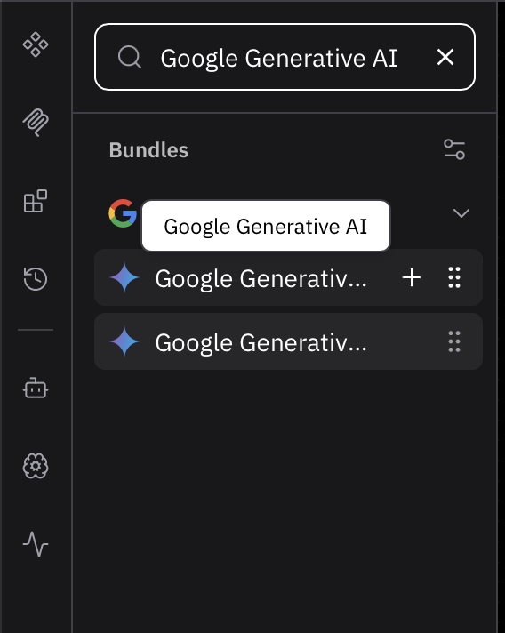

---

### Step 4: Configure Model to gemini-3-flash-preview

On the **Google Generative AI** component card on your canvas, configure the following settings:

1. **Model**:
   - In the **Model** dropdown, select or type **`gemini-3-flash-preview`**.
2. **Google API Key**:
   - Click into the **Google API Key** field and paste the API key you copied from Google AI Studio.
3. **Max Output Tokens**:
   - Set to **`100`** (ensures verification responses are instantaneous and conserves quota).
4. **Temperature**:
   - Set to **`0.10`** (deterministic responses).
5. **System Message**:
   - Click the expand icon on **System Message** and enter:
     ```text
     You are the API Verification Assistant. If the API is functioning properly, respond strictly with: "🟢 API Working".
     ```

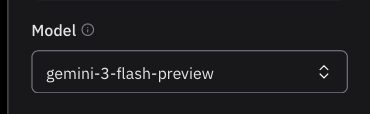

---

### Step 5: Add Chat Output Component

1. Return to the sidebar search bar and search for **`Chat`** (or expand **Input & Output**).
2. Locate **`Chat Output`**.
3. Click and drag **`Chat Output`** onto the right side of your canvas.

---

### Step 6: Wire the Components

Connect the nodes left-to-right to establish data flow:

1. Click and drag the handle from **`Chat Input`** (`Chat Message` purple circle on the right) and connect it to **`Google Generative AI`** (`Input` purple circle on the left).
2. Click and drag the handle from **`Google Generative AI`** (`Model Response` purple circle at the bottom right) and connect it to **`Chat Output`** (`Inputs*` purple circle on the left).

Your completed test flow will look like this:

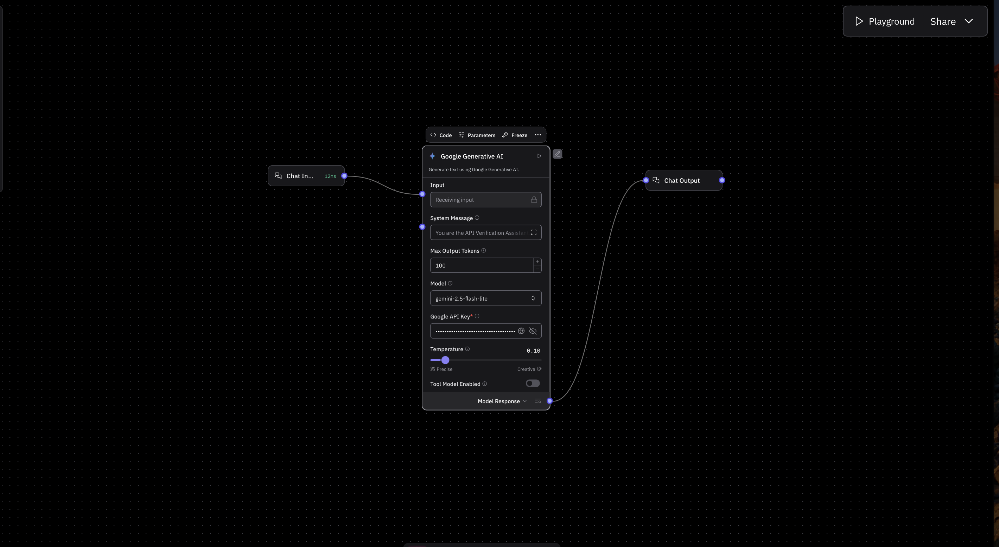

---

### Step 7: Run the Test in Playground

1. Click the **`▷ Playground`** button in the top-right corner of the canvas.
2. The interactive chat testing window will open.
3. Locate the message input box at the bottom of the screen. Type: **`Is the API working?`** (or simply `Ping`).

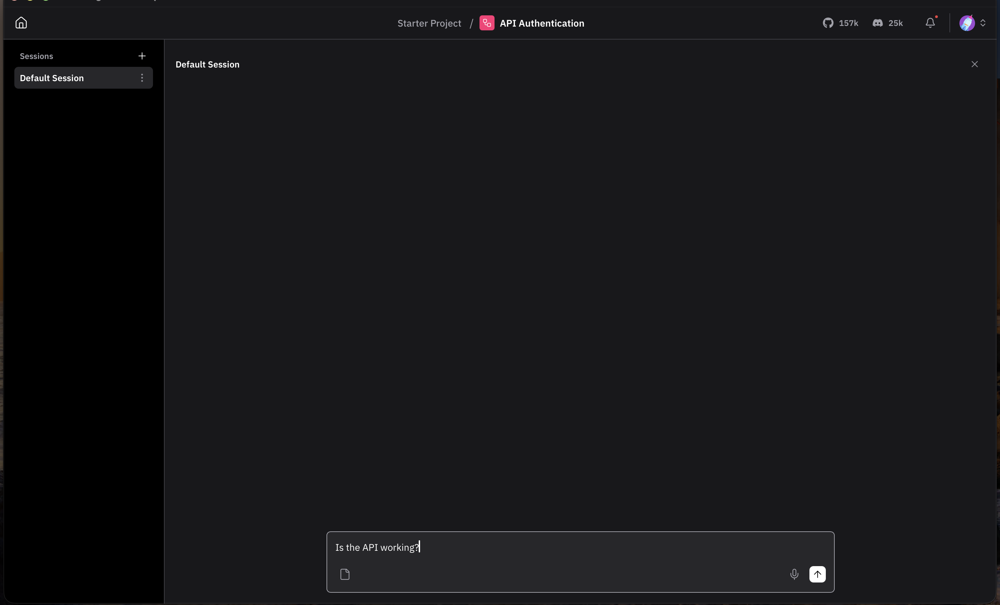

4. Click the **Send** button (the up arrow icon `↑`) or press Enter.
5. Within 1–2 seconds, the model will process the input and display the confirmation response:
   ```text
   🟢 API Status: Connected & Fully Operational!
   Yes, the API is working perfectly. How can I assist you today?
   ```
6. The green execution badge (`✓ Finished in ...s`) confirms that your Gemini API key, network connectivity, and Langflow installation are 100% verified and operational!

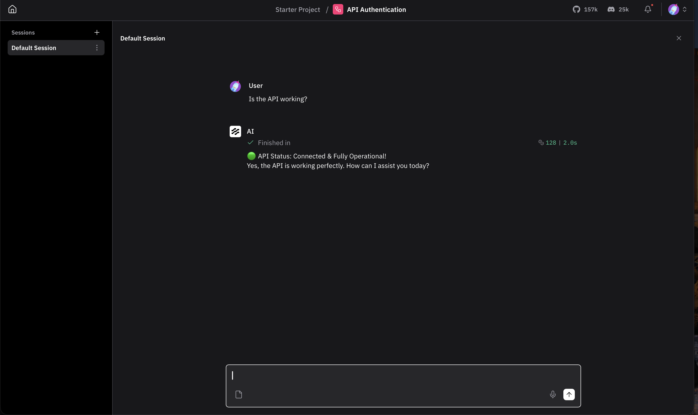

---

## Workshop Readiness Checklist

Ensure you have checked off all items before the workshop begins:

- [ ] **Google AI Studio Key Generated**: API key created and copied from Google AI Studio console.
- [ ] **Langflow Desktop Installed**: App installed and successfully launched on your Mac or Windows laptop.
- [ ] **Blank Flow Created**: Verified you can open a new flow canvas without errors.
- [ ] **Google Generative AI Node Selected**: Confirmed you selected the LLM component (and **not** Embeddings).
- [ ] **Model Set to `gemini-3-flash-preview`**: Model field configured with your API key.
- [ ] **Playground Test Passed**: Verified that sending a test message returns a successful response (`🟢 API Status: Connected...`).
- [ ] **Power & Internet**: Laptop charger plugged in and stable internet connection ready.

---

## Features

- **No-Terminal Installation**: One-click `.exe` and `.dmg` installers designed for non-technical users.
- **Complete Visual Onboarding**: Real screenshots detailing project creation and API key generation.
- **Low-Code Visual Canvas**: Drag, wire, and inspect cognitive architectures without writing boilerplate code.
- **Interactive Playground**: Test and chat with your agent flows directly in real time.

---

## Troubleshooting

| Problem | Root Cause | Fix |
| :--- | :--- | :--- |
| `Validation Failed / An unexpected error occurred` | Langflow Desktop provider modal connection error | Close the modal. Drag **Google Generative AI** directly onto the canvas and paste your API key inside the component. |
| `429 TooManyRequests` | Gemini API free quota rate limit exceeded | Change the model from `gemini-pro` to `gemini-1.5-flash` or `gemini-2.5-flash` in the model component. |
| *Windows SmartScreen warning* | Unrecognized downloaded installer | Click **More info**, then click **Run anyway**. |
| `Linux: Port 7860 already in use` | Another service is listening on port 7860 | Specify an alternate port: `uvx langflow run --port 7861` and navigate to `http://127.0.0.1:7861`. |
| `Linux: ValueError: Username and password must be set` | Langflow authentication enabled without environment configuration | Set `export LANGFLOW_AUTO_LOGIN=true` before running `uvx langflow run`. |
| *Application runs slowly* | High RAM usage from background processes | Close unnecessary browser tabs and background applications during execution. |

---

## License

This project is licensed under the MIT License. See the [LICENSE](LICENSE) file for details.
